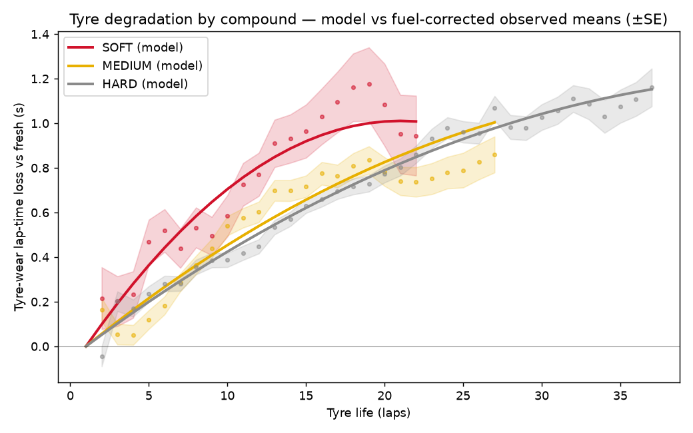
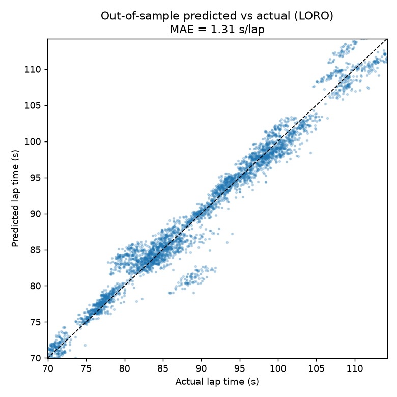
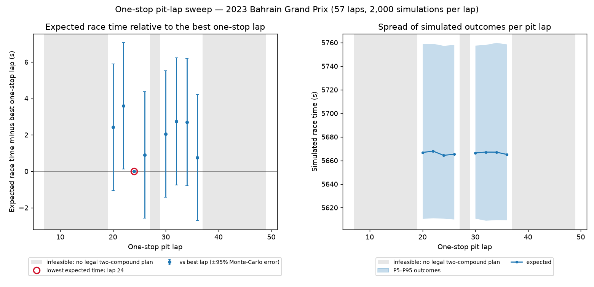

# PitWall — F1 tyre-degradation modelling & pit-strategy simulation

**Question:** given three seasons of real Formula 1 race data, can we (a) estimate how
each tyre compound degrades once fuel and circuit effects are stripped out, and (b) use
that model to choose a pit-stop strategy — and how does that strategy compare to what the
teams actually did?

## Results at a glance

| | Result | Source |
| --- | --- | --- |
| Lap-time model, out-of-sample | **1.31 s/lap MAE vs 1.71 s/lap** for a per-circuit × compound baseline (**23.4% lower**) | `results/model_metrics.json` |
| Simulator vs the field, stop count | **56.1%** of 57 races (32) | `results/backtest.json` |
| Simulator vs the field, stop count and every pit lap ±3 | **12.3%** (7 of 57) | `results/backtest.json` |
| Pit-lap offset where stop counts match | simulator pits **+6.6 laps later** than the field on average | `results/backtest.json` |

The model is a real improvement on a baseline that already knows the circuit, though part
of the gain may be its fuel term (see [limitations](#design-decisions-and-limitations)).
The simulator finds the pace-optimal window and misses the earlier stops teams make for
track position, which it does not model.



Every number in this README comes from running the code in this repo; the files in
`results/` hold them. `data/laps_clean.parquet` and `data/race_laps.parquet` are
committed, so the model fit, the backtest and the figures re-run on a fresh clone without
the slow FastF1 ingest ([Reproduce](#reproduce)).

## Architecture

PitWall is an offline batch pipeline: six scripts, each reading the previous step's
files. Nothing runs as a service.

```
FastF1 API
   │  scripts/ingest.py           (slow, rate-limited; not needed to reproduce)
   ▼
data/raw/*.parquet                 68 races, gitignored
   ├─ scripts/build_clean.py     → data/laps_clean.parquet   (Tier 1, committed)
   │                               results/exclusion_table.*, tier1_summary.json
   └─ scripts/build_race_laps.py → data/race_laps.parquet    (10 raw-lap columns, committed)

data/laps_clean.parquet
   └─ scripts/fit_model.py       → results/model_full.pkl (stamped with the clean-data
                                    sha256), model_metrics.json, cv_predictions.npz (Tier 2)

laps_clean + race_laps + model_full.pkl
   ├─ scripts/backtest.py        → results/backtest.json, backtest_table.md        (Tier 3)
   │                               (--holdout-circuit-inputs → backtest_holdout.*)
   └─ scripts/make_figures.py    → figures/*.png
```

- `src/pitwall/clean.py` — one function per exclusion rule.
- `src/pitwall/model.py` — the MixedLM degradation model and both baselines.
- `src/pitwall/simulate.py` — the Monte-Carlo race simulator and pit-plan search.
- `src/pitwall/race_laps.py` — the raw-lap slice Tier 3 reads, and which tyre changes
  count as strategic stops.
- `src/pitwall/artifacts.py` — loads the fitted model and refuses it if it was fitted on
  a different `laps_clean.parquet`.

## Data

- **Source:** [FastF1](https://docs.fastf1.dev/), race sessions only.
- **Scope:** **3 full seasons (2022, 2023, 2024) — 68 races, 0 ingestion failures.**
- Ingestion is resumable and rate-limit-aware (`scripts/ingest.py`): each race is a
  separate parquet, failures are logged and retried, and a manifest records exactly what
  landed.

## Tier 1 — Clean lap dataset

Each exclusion rule is a separately tested function (`src/pitwall/clean.py`), applied in
order. Rules that need a stint context (outliers, short stints) run last. Wet/mixed-
condition races are dropped entirely so the degradation model owns a clean dry-tyre
problem.

**74,601 raw laps → 53,854 valid laps across 2,824 stints (59 of 68 races retain dry-race data).**

| rule | removed | remaining |
| --- | --- | --- |
| null_laptime | 1187 | 73414 |
| null_tyrelife | 543 | 72871 |
| lap_1 | 1324 | 71547 |
| pit_in_out_laps | 4406 | 67141 |
| non_green_track_status | 5223 | 61918 |
| mixed_condition_race | 7536 | 54382 |
| wet_intermediate_laps | 0 | 54382 |
| unknown_compound | 26 | 54356 |
| stint_median_outlier_7pct | 91 | 54265 |
| short_stint_lt5 | 411 | 53854 |

(`wet_intermediate_laps` removes 0 because `mixed_condition_race` already drops every
wet-affected race in full — the two rules are kept separate so each is auditable.)

## Tier 2 — Degradation model

Lap time is dominated by fuel and circuit, not tyre wear, so both are removed before
degradation is estimated:

- **Circuit** — absorbed by centering lap time on the per-circuit mean (a circuit fixed
  intercept). This also makes cross-validation robust: a held-out race's circuit intercept
  comes from the *other* season's running of that circuit.
- **Fuel / track evolution** — `race_progress` (lap ÷ race length) as a linear fixed effect.
- **Season** — a fixed effect for the annual car/regulation pace step.
- **Tyre wear** — compound-specific **linear + quadratic** `tyre_life` terms, so each
  compound gets its own degradation curve.
- **Driver** — a random intercept grouped by driver-season (`statsmodels` **MixedLM**).

The MixedLM **converged on the full dataset and on all cross-validation folds**; the
documented fallback (OLS with driver fixed effects) was not needed. Every one of those 56
fits (55 folds + the full fit) also logs a statsmodels `SingularMatrixWarning` ("random
effects covariance is singular") during optimisation. The fitted driver-season intercepts
are not degenerate (SD 0.64 s across 68 driver-seasons), but the warning means the
random-effect variance estimate is less certain than a clean fit's would be.

**Baseline** (the honest comparison): a **per-(circuit, compound) OLS** of lap time on
`tyre_life`. This baseline already knows which circuit it is at and gets a compound-specific
linear degradation slope, so beating it isolates exactly what the full model adds — fuel
correction, nonlinear wear, driver effects, and partial pooling — rather than the trivial
"which track is this."

**Validation:** leave-one-race-out over the 55 races at the 21 circuits with cross-season
data (the held-out race is never in training). Error is mean absolute lap-time error in seconds.

| | Model (MixedLM) | Fair baseline (per-circuit × compound OLS) |
| --- | --- | --- |
| **CV MAE (s/lap)** | **1.31** | 1.71 |
| SOFT | 1.91 | 2.48 |
| MEDIUM | 1.35 | 1.68 |
| HARD | 1.14 | 1.55 |

**The model is 23.4% better than a baseline that already knows the circuit** (1.31 vs 1.71
s/lap out-of-sample), and wins on every compound. It is weakest on SOFT (1.91 s/lap) — softs
run short, aggressive stints and are the most variable compound.

The baseline has no lap-number (fuel / track-evolution) term, and the model does: the
fitted `race_progress` coefficient is −3.03 s, so a lap at the flag is about 3 s faster
than a lap at the start, all else equal. An unknown share of the 23.4% is therefore fuel
correction rather than better degradation modelling. A baseline with a lap term would
separate the two; it has not been run.

> A naive per-compound OLS with *no* circuit term scores 9.06 s/lap, but that number mostly
> measures the baseline not knowing whether it's at Monaco or Spa — so it is reported only as
> a reference, not as the model's improvement.



## Tier 3 — Monte-Carlo strategy simulator

For a race (circuit, laps, compounds) and a stint plan, race time is a deterministic
degradation sum plus stochastic draws — all estimated from the data, none hardcoded:

- **pit-lane loss** — per-circuit empirical pool from real in/out-lap deltas; per-circuit
  medians run from 19.8 s (Belgium) to 35.4 s (Canada) over the 24 backtested circuits
  (`pit_loss_median_s_by_circuit` in `results/backtest.json`).
- **safety car** — Bernoulli occurrence at the per-circuit historical rate, start lap from
  the circuit's historical SC-lap pool; SC laps cost time and a stop taken in the SC window
  is discounted (the "cheap stop").
- **lap-time noise** — from the fitted model's residual spread (σ ≈ 1.46 s/lap).

Physical tyre life is capped per compound at the 90th-percentile stint actually run
(SOFT 22, MEDIUM 27, HARD 37 laps), so the optimiser can't "run" an impossible stint. It
enumerates one- and two-stop plans over a pit-lap grid (2,000 sims each) and returns the
plan with the lowest expected race time and its P5–P95 band.



The figure sweeps every one-stop pit lap for the 2023 Bahrain GP. On the left, each
feasible lap's expected race time is within about 4 s of the best lap (24), and most 95%
Monte-Carlo error bars cross zero, so the simulator cannot tell those laps apart on pace.
Grey bands are pit laps where no legal two-compound plan fits the tyre-life caps. On the
right, the P5–P95 band is about 150 s wide, mostly from safety-car risk.

### Backtest vs the field (57 races)

Agreement is defined up front as **same stop count *and* every pit lap within ±3 laps** of
the field's median strategy.

The field's strategy counts only strategic stops:

- A pit entry counts only if the tyres changed (a new compound, or tyre life that does
  not simply continue). This drops pit-lane passes on the same tyres, such as the field
  being routed through the pit lane behind the safety car in 2024 Qatar.
- Tyre changes on lap 1 or 2 (damage, first-lap incidents) are dropped.
- Tyre changes under a red flag are dropped, because they are free while the race is
  suspended. FastF1 gives track status per lap, not per stop, so this is approximate: a
  stop is dropped when its in-lap or the next lap shows a red flag.
- Safety-car stops are kept, because in many races the field's only planned stop was
  made under the safety car.

Two races, 2023 Australia and 2024 Monaco, have no strategic stop left and are not
backtested.

- **Stop-count agreement: 56.1%** (32 of 57) — the simulator picks the right number of
  stops about half the time.
- **Strict (stop count + pit laps ±3) agreement: 12.3%** (7 of 57).
- **Mean pit-lap offset: +6.6 laps** (median +6) — the simulator pits *later* than the
  teams.

**What is and isn't in-sample.** The actual pit laps are never an input to the simulator.
Everything else is built from every race in the data, including the one being
backtested: the
degradation model, the stint caps, and each circuit's pit-loss pool, safety-car rate and
safety-car start laps (so the target race's own safety-car lap is in the pool). Re-running
with the circuit inputs rebuilt without the target race
(`scripts/backtest.py --holdout-circuit-inputs` → `results/backtest_holdout.json`) gives
the same stop-count agreement, 56.1% (32 of 57), strict agreement 8.8% (5 of 57), and a
mean offset of +6.0 laps (median +6). The model and stint caps stay in-sample in both runs.

That offset is the main finding: the simulator finds the **pace-optimal** pit window,
while real teams pit about 6–7 laps earlier to execute **undercuts** and defend track
position, which a pace-only model does not contain. The pit-window figure shows why
exact-lap agreement is low: across a wide window the expected-time differences are within
Monte-Carlo noise, so pace alone doesn't pin down a lap.

## Design decisions and limitations

Read these before trusting a number.

- **No undercut / track-position model.** The simulator optimises pure race pace, so it
  systematically pits later than reality (+6.6 laps). This is the single biggest gap.
- **The baseline has no fuel term.** Part of the 23.4% gain may be fuel correction rather
  than degradation modelling (see Tier 2).
- **The degradation curves are quadratic, not constrained to rise.** The SOFT curve
  flattens and turns down slightly after about lap 20, and the MEDIUM and HARD curves
  nearly coincide, while the observed MEDIUM means sit below HARD after about lap 20. Long
  SOFT stints are rare and selected (only tyres that are holding up are kept out), so the
  late SOFT curve should not be read as tyres getting faster.
- **Singular random-effects warnings.** Every MixedLM fit logs a singular-covariance
  warning (see Tier 2); the fits converge and the driver intercepts are non-zero.
- **No traffic model** — clean-air pace only; the ~7% stint-median outlier filter removes
  most traffic-affected laps but also trims genuine end-of-stint "cliff" laps, so the fitted
  degradation is closer to linear than the real nonlinear cliff.
- **Dry races only** — wet/intermediate laps and mixed-condition races are excluded.
- **Degradation is per-compound, not per-driver** (drivers enter only as a random
  intercept, not as random slopes).
- **Simplified safety-car model** — fixed duration and slowdown factor; SC rates at some
  circuits rest on only 2–3 races.
- **Committed derived data instead of raw data.** The raw FastF1 pulls are gitignored;
  `data/race_laps.parquet` (10 columns, ~390 KB) is the part of them Tier 3 needs. Changing
  the cleaning rules or the season range still needs a fresh ingest.
- **Stale-model guard.** `results/model_full.pkl` records the sha256 of the
  `laps_clean.parquet` it was fitted on; the backtest and figures refuse to run on a
  mismatch instead of silently using an old model.

## Reproduce

From a fresh clone, with [uv](https://docs.astral.sh/uv/) (or `pip install -e ".[dev]"`
and drop the `uv run`):

```bash
uv sync --extra dev
uv run pytest -q                       # 30 tests
uv run python scripts/fit_model.py     # Tier 2: LORO CV -> results/model_metrics.json (~20 s)
uv run python scripts/backtest.py      # Tier 3 -> results/backtest.json (~70 s)
uv run python scripts/backtest.py --holdout-circuit-inputs  # -> results/backtest_holdout.json
uv run python scripts/make_figures.py  # figures/*.png (~5 s)
```

These read only committed files and rewrite the committed results with the same values.

To rebuild from scratch (network access to FastF1 needed; resumable, rate-limited):

```bash
uv run python scripts/ingest.py           # 3 seasons -> data/raw/*.parquet
uv run python scripts/build_clean.py      # Tier 1 -> data/laps_clean.parquet + exclusion table
uv run python scripts/build_race_laps.py  # data/race_laps.parquet for Tier 3 and the figures
```

## Tests (30, run in CI on every push)

One test per exclusion rule, a degradation-monotonicity test (predicted lap time rises with
tyre life within a compound), a circuit-offset recovery test, simulator sanity tests (zero
degradation + real pit loss ⇒ fewest stops; strong wear + free stops ⇒ more stops; ordered
percentile band; Monte-Carlo error matches the lap noise), the stale-model guard, which
tyre changes count as strategic stops (including pit-lane passes on the same tyres), and a regression test pinning the clean-lap count.

## Layout

```
src/pitwall/   clean.py · model.py · simulate.py · race_laps.py · artifacts.py · config.py
scripts/       ingest.py · build_clean.py · build_race_laps.py · fit_model.py · backtest.py
               make_figures.py
tests/         test_clean.py · test_model.py · test_simulate.py · test_race_laps.py
               test_artifacts.py
data/          laps_clean.parquet · race_laps.parquet · ingest_manifest.json (committed)
results/       metrics JSON, fitted model, exclusion table, backtest tables (committed)
figures/       the three PNGs above
```

## License

The code is MIT-licensed — see [LICENSE](LICENSE). The licence covers the code only.

The committed data (`data/laps_clean.parquet`, `data/race_laps.parquet`) is derived from
Formula 1 live-timing data, retrieved with [FastF1](https://docs.fastf1.dev/). It is not
covered by the MIT licence, is included only for non-commercial research and
reproducibility, and will be removed on request from the rights holder. See
[data/README.md](data/README.md).
